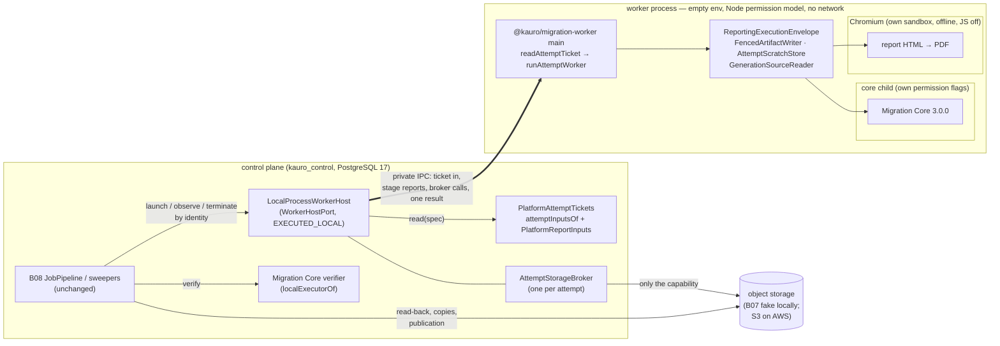

# B14-A — The real worker executor, B13 inside it, and the AWS host's contracts

Order 9, the first part of B14. It is local and synthetic: no AWS account or resource, no customer data, no real secret, no
deployment. It builds a real executor that runs **Migration Core 3.0.0 and the B13 PDF report in an isolated process**, under B08's
unchanged control plane. It also qualifies the AWS host on documentation ([B14-A-aws-host-qualification.md](B14-A-aws-host-qualification.md))
and writes the deployment contracts ([deploy/aws/worker/](../../deploy/aws/worker/README.md)). It does not complete B14, and nothing
here is production-ready.

## 1. What existed, what was simulated, what was not connected (preflight, `main` 9dd3a3b3)

| Piece | State before order 9 |
|---|---|
| `WorkerHostPort` (`application/ports/worker-host.ts`) | Port only. The only implementer was `ContractFakeWorkerHost`, an **in-process** executor (SIMULATED) that every B08 and B13 control-plane test bound. |
| `MigrationCoreAdapter` (B05) | Real (EXECUTED_LOCAL), and tested on its own. The B08 pipeline never ran it: every B08 and B13 end-to-end test bound a core that replays an acceptance package. |
| `ReportingExecutionEnvelope`, `PlatformReportInputs`, `FencedArtifactWriter`, `AttemptScratchStore`, `ChromiumPdfEngine` | Real, each tested; never in one process with the real core, and never outside the test process. |
| A composition root for a worker | None (`@kauro/migration-worker` was reserved in `architecture.rules.json`; no package). |
| The core's configuration at execution | **Not connected.** The pipeline's `specOf` passes the platform's plan body and plan hash as `configDocument`/`configHash`. The real adapter needs the core plan binding (`core_plan_bindings`, D5-16). |
| The revision's inputs as the core reads them (`CoreInputResolver`) | **No implementation** outside tests. |
| The real verifier inside the pipeline | **Not connected.** `MigrationCoreAdapter.verify` needs `controls.limits`, which `JobPipeline.verify` does not pass. |
| Execute vs. validate package | **Different bytes** (found here, §9 F1): every real report would have been refused. |
| A worker without database credentials | Asserted in design (D8-ATT-2), never exercised: no worker process existed. |

## 2. Composition and security boundaries

Boundaries, from the outside in:

1. **No credential crosses into the worker.** Its environment is empty; only `SystemRoot` is passed, plus on Windows the variables
   libuv requires for CreateProcess. It never opens a database connection. Every report input arrives inside the ticket, already
   read by the control plane, and the worker verifies each one again (`assembleReportFacts`).
2. **Every object goes through the broker.** The broker admits only the attempt's sealed generations for reading and its own
   staging prefix for writing. It hands out opaque session handles; the provider's bearer reference never reaches the worker. After
   a termination, a deadline or the result, it is revoked.
3. **The process is confined.** The Node permission model lets the worker read only the code, the browser's directory and its own
   attempt directory, and write only that directory. The network entry points are refused (the sandbox preload). The heap is
   bounded, and so are the scratch quota and the wall clock.
4. **Inside the worker,** the core runs in its own child with narrower flags (B05). Chromium runs with its own sandbox, offline, with
   JavaScript off and every request aborted (B13).
5. **On AWS** (qualification §4), the task and its per-attempt IAM role replace items 2 and 3 as the hard boundary. The worker's code
   is the same.

## 3. The attempt ticket (KAURO_ATTEMPT_TICKET_V1)

The ticket is the worker's one closed input, built by the host at launch (`packages/data-plane/src/host/ticket.ts`). It contains:
the B08 launch spec (identity, capability, subject, limits, fence); the **core plan binding** of the job's plan; the revision's
INCLUDED files as the core reads them (`source_files.format`); the report's inputs (`PlatformReportInputs.read(scope)`); the render
configuration; the expected core package hash; and the instant of issue. Bytes inside it are encoded as `{"$bytes": base64}`.

- The worker checks the ticket's raw SHA-256 against the digest on its command line. The bytes must be exactly the canonical
  encoding: one spelling only.
- `attemptTicketProblems` refuses: another attempt's identity, capability or subject; no fence; limits past their hard bounds; no
  binding; inputs that are not exactly the capability's sealed generations; a read configuration the core cannot use; no render; no
  core hash; no deadline; any member that does not belong.
- The host checks the same before it creates anything (`REFUSED`, nothing created). The worker checks again before it touches
  storage (`FAILED REFUSED`).
- The plan binding is applied by the worker (`planBound` in `worker-runtime.ts`): the core runs on the binding's document and its
  core-native hash, which is what D5-16 requires ("execute translates a plan only through this row"). The B08 pipeline and its
  `ExecutionSubject` are unchanged.

The report's inputs are read **at launch**, not at print time, so the worker needs no channel to the database. Those records are
immutable (quote preimage, legal identity, the branding bound once per job, the audit's findings, the approval's disclosures). The
authority facts that can change (authorization, approval, source, target, capability) are read again by B08's publication guard,
which refuses a stale package as before.

## 4. The local worker protocol and the broker

The worker and its host talk over a private IPC channel with Node's advanced serialization (`host/protocol.ts`, `client.ts`,
`broker.ts`):

- host → worker: `ticket`, `reply`, `signal` (the host's mirror of the lease's cancellation, D8-CANCEL-1);
- worker → host: `call` (a stage report, or a storage call to the broker), `beat` (a heartbeat at each cancellation check),
  `result` (sent once).

Stage reports (`STARTED`, `CORE_STARTED`, `CORE_FINISHED`, `PDF_STARTED`, `PDF_FINISHED`, `MANIFEST`, `FINISHED`) are calls the host
answers. A deployment answers them at once; a test can hold one. That is how the tests below terminate, cancel or time out at an
exact point without sleeping.

The broker refuses with a token and keeps each refusal (operation and token) as evidence. Reads are pulled one chunk at a time, at
most 1 MiB, so memory stays bounded.

## 5. The local process host and its limits

`LocalProcessWorkerHost` (`host/local-process-host.ts`):

- **Creation by identity.** The create is the exclusive `mkdir` of `jobs/<identity>` under the host root. A second launch, a
  concurrent one, a redelivery, or another host instance over the same root answers `ALREADY_EXISTS`. The control plane's records
  are read before the create, so a failed read creates nothing. The job's durable record (`record.json`, written atomically) holds
  state, pid, instants, cause, manifest reference, refusal, peaks and the exact command line. It never holds a customer value.
- **Configuration refused before it exists.** Relative paths, a missing entry or browser, no code roots, a host or scratch root
  that overlaps a code root the worker can read, overlapping host and scratch roots, a non-https session origin, or a malformed core
  hash. At launch, the two heaps plus the browser's reserve must fit in the attempt's hard memory.
- **Limits.**
  - Memory: `--max-old-space-size` on the worker, `heapMegabytes` on the core child, and the browser's reserve inside the attempt's
    `hardMemoryBytes`.
  - Disk: the attempt's scratch quota (AttemptScratchStore and the core's byte ledger).
  - Time: the worker's own deadline (the adapter's `Operation`), and the host's timer at the earlier of the execution deadline and
    the wall clock. When that timer fires, the host kills the tree and records `DEADLINE_EXCEEDED`.
- **Termination** revokes the broker first, then kills the worker's whole tree. On Linux this walks `/proc` and then kills the
  worker's process group; on Windows it uses `taskkill /T /F`. The browser and the core child go with the worker.
- **Restart.** A worker whose host's channel closes ends itself and everything it started (`killOwnTree`). A new host over the same
  root answers the identity from its durable record: `FAILED WORKER_CRASHED` (`HOST_RESTARTED`), never `NOT_FOUND`. B08 then
  abandons the attempt and takes it over at fence + 1.

**Residual (local only), recorded by a test:** a *native* program started by the worker is not confined by Node's permission model.
A Node child inherits it, and a hostile worker proves both. What still holds is boundary 1 (no credential) and boundary 2 (no storage
except through the broker). Another attempt's leftover scratch on the same disk, before the janitor removes it, is readable by such a
program run as the same OS user. The local host is therefore for qualification and development; multi-tenant isolation is the cloud
task's, one attempt per task. An OS-level sandbox for the local host would close this residual and is not built.

## 6. B13 inside the worker

The report is made exactly as B13 designed it (`ReportingExecutionEnvelope`), now inside the worker process and over the real
core's package:

- The facts come from `PlatformReportInputs`, through the ticket. The renderer never reads a table, and the worker cannot.
- The branding version is the one bound to the job (bound once, at first read). The issuer is the legal identity document whose hash
  the quote's terms name. The commercial display name and the fiscal identity stay separate bindings, as before.
- **The missing legal identity still blocks every real report:** `REPORT_ISSUER_UNAVAILABLE`, job `FAILED REFUSED`, nothing
  published. Tests use only the labelled synthetic TEST identity of `@kauro/persistence/testing`.
- Publication is B08's own: the PDF and its record are artifacts of the staged manifest. A worker killed before its manifest leaves
  nothing that can be submitted, so a package is never published without its report, and never partially.
- Hashes are unchanged: the record names the core's manifest hash, which now equals the receipt's `artifactEvidenceHash` (§9 F1).

## 7. The control plane's side

- `attemptInputsOf(uow)` (`packages/persistence/src/execution/attempt-inputs.ts`) reads the binding and the sealed files. It runs as
  `kauro_control` bound to the job's agency and needs no new grant (0058 and 0021 already give them); there is no migration.
- `PlatformAttemptTickets` (`apps/control/src/execution/attempt-tickets.ts`) is that read plus `PlatformReportInputs`.
- `localExecutorOf` (`apps/control/src/execution/local-executor.ts`) builds the host, plus a `PackageVerifierPort` over Migration
  Core's own `verify` with the envelope's limits. The deployed control plane still binds no executor (D8-PORT-1).

## 8. Evidence

Windows 11, Node 24.20.0, PostgreSQL 17 (`pg17dl`), Microsoft Edge (Chromium) sandboxed. CI runs the same suites on Ubuntu 24.04 and
Windows with Google Chrome required (`KAURO_REQUIRE_PDF_ENGINE=1`).

| Suite | File | Cases |
|---|---|---|
| Ticket and broker, pure | `packages/data-plane/test/worker-ticket-broker.test.ts` | 4: digest, canonical bytes, closed shape (18 refusals), broker OK, broker DENY (14 refusals and revocation) |
| Local executor, happy path | `packages/data-plane/test/local-process-host.test.ts` | 1: real Migration Core and Chromium in a confined process; the manifest names the package, the PDF and its record; scratch removed |
| Local executor, adversarial | `packages/data-plane/test/local-process-host-adversarial.test.ts` | 14: concurrent and duplicate launches and a second host; lost answer and failed read; configuration refused; hostile worker (environment, files, writes, socket, fetch, DNS, broker, residual); memory (heap death recorded MEMORY_EXHAUSTED); disk (SCRATCH_EXHAUSTED); time (DEADLINE_EXCEEDED, and a deadline already past); termination during processing, during the PDF and before publication (no process survives, OS-checked); cancellation and fence; control-plane death (an orphan ends itself, recovery from the record); missing legal identity; altered and forged sealed generations |
| End to end, PostgreSQL 17 | `apps/control/test/b14a-local-executor.test.ts` | 5: OK (package AVAILABLE, job READY, entitlement DELIVERED, verification VALID EXECUTED_LOCAL 3.0.0, delivered manifest = the receipt's, janitor CLEANED with REPORTED resources); S056 lost answer adopted through B08; CMD037 during the run; worker killed, then takeover at fence 2 delivers; no legal identity → FAILED REFUSED |
| Regressions | data-plane, control, persistence, application suites; `pnpm run verify` | B05 adapter (with F1), B08 control plane, B13 report suites unchanged and green |

Set `KAURO_B14A_EVIDENCE_DIR` to make the end-to-end OK case write the delivered PDF, its record, the host's record and the delivery
summary.

Evidence classes: EXECUTED_LOCAL for the host, the worker processes, Migration Core, the browser, the control plane and PostgreSQL.
SIMULATED for B07's object storage (no cloud storage exists locally) and the payment capture (B09's fixtures). **Nothing here is
EXECUTED_PROVIDER.**

## 9. Findings fixed (each with the test that shows it)

| # | Finding | Fix |
|---|---|---|
| F1 | `execute` ran without the source profile that `validate` builds. The staged package therefore never had the receipt's `artifactEvidenceHash`, and every real report was refused `PACKAGE_BINDING_MISMATCH`. | `child-task.ts`: execute builds the profile exactly as validate does. The package is now byte for byte the validated one (asserted end to end). |
| F2 | The B08 subject carries the plan body and plan hash, not the core's configuration. | The worker applies the plan binding from the ticket (§3). B08 is unchanged. |
| F3 | The real verifier needs `controls.limits`; the pipeline passes none. | `localExecutorOf` binds the verifier with the plane's limits. |
| F4 | Under Node 24's permission model `fsync` is disabled, and a directory's contents are granted only if the directory exists when the process starts. | The host creates the attempt directory before spawning. `AttemptScratchStore` gains `confined` (no root `mkdir`, no `fsync`; the length on the device is still checked). |
| F5 | On Windows a process's working directory cannot be removed. | The worker's working directory is the scratch root, which it cannot read. |

## 10. Decisions

| Id | Decision |
|---|---|
| D14A-1 | The local executor is a `WorkerHostPort` of its own (EXECUTED_LOCAL). The port's evidence class widens to `WorkerHostEvidenceClass` = provider classes + EXECUTED_LOCAL; the janitor's rule (EXECUTED_PROVIDER only from a provider host and provider storage) is unchanged. |
| D14A-2 | The worker reads nothing of the platform but its ticket. The report's inputs are read at launch by the control plane (§3). |
| D14A-3 | Storage is brokered locally; on AWS it is per-attempt IAM (qualification §4). The same object names and preconditions apply in both. |
| D14A-4 | The host creates by an exclusive directory per identity (locally) or by `clientToken` plus a conditional claim object (AWS). Neither relies on a provider's search by name. |
| D14A-5 | The worker's clock is the product's fifth process-clock injection point (CK3, `apps/migration-worker/src/main.ts` `workerClock`). |
| D14A-6 | `BrokeredObjectStorage` is a real implementer of `ObjectStoragePort` (a client of the broker, not a fake). The B07 single-fake check lists it explicitly. |
| D14A-7 | The new areas (`apps/migration-worker/**`, `deploy/**`) are attributed to B08 and B13 in the acceptance ledger: a change to them re-touches both. |

## 11. Still blocked (needs AWS, the legal identity, or another service)

- **AWS:** account, provisioning authorization, Terraform, the image's first build, `EcsFargateWorkerHost`, B15's S3 adapter and its
  generation mapping, and the live probes of the qualification's §6 (token, Chromium sandbox on Fargate, IAM life cycle, bucket
  policy, pull time, task retirement). Until then: no EXECUTED_PROVIDER, no G-CLOUD, no `B14_COMPLETO`.
- **Legal identity:** every real report is refused until the owner records it (`docs/owner/LEGAL_IDENTITY_SNAPSHOT.md`).
- **Local residual:** an OS-level sandbox for the local host (§5), if the local host is ever used beyond qualification.
- **Not in B14-A:** B14's database, API, queues and network beyond the worker; B04 and Bedrock.
