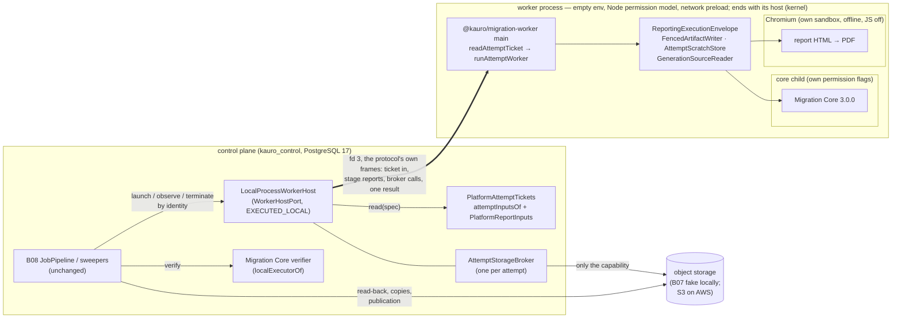

# B14-A — The real worker executor, B13 inside it, and the AWS host's contracts

Order 9, the first part of B14. It is local and synthetic: no AWS account or resource, no customer data, no real secret, no
deployment. It builds a real executor that runs **Migration Core 3.0.0 and the B13 PDF report in an isolated process**, under B08's
unchanged control plane. It also selects the AWS host from the official documentation, without qualifying it ([B14-A-aws-host-qualification.md](B14-A-aws-host-qualification.md))
and writes the deployment contracts ([deploy/aws/worker/](../../deploy/aws/worker/README.md)). It does not complete B14, and nothing
here is production-ready.

## 1. What existed, what was simulated, what was not connected (preflight, `main` 9dd3a3b3)

| Piece | State before order 9 |
|---|---|
| `WorkerHostPort` (`application/ports/worker-host.ts`) | Port only. The only implementer was `ContractFakeWorkerHost`, an **in-process** executor (SIMULATED) that every B08 and B13 control-plane test bound. |
| `MigrationCoreAdapter` (B05) | Real (EXECUTED_LOCAL), and tested on its own. The B08 pipeline never ran it: every B08 and B13 end-to-end test bound a core that replays an acceptance package. |
| `ReportingExecutionEnvelope`, `PlatformReportInputs`, `FencedArtifactWriter`, `AttemptScratchStore`, `ChromiumPdfEngine` | Real, each tested; never in one process with the real core, and never outside the test process. |
| A composition root for a worker | None (`@kauro/migration-worker` was reserved in `architecture.rules.json`; no package). |
| The core's configuration at execution | **Not connected.** The pipeline's `specOf` passes the platform's plan body and plan hash as `configDocument`/`configHash`. The real adapter needs the core plan binding (`core_plan_bindings`, D5-16). |
| The revision's inputs as the core reads them (`CoreInputResolver`) | **No implementation** outside tests. |
| The real verifier inside the pipeline | **Not connected.** `MigrationCoreAdapter.verify` needs `controls.limits`, which `JobPipeline.verify` does not pass. |
| Execute vs. validate package | **Different bytes** (found here, §9 F1): every real report would have been refused. |
| A worker without database credentials | Asserted in design (D8-ATT-2), never exercised: no worker process existed. |

## 2. Composition and security boundaries

Boundaries, from the outside in. The local host's trust model is stated in its configuration (`isolation:
"SINGLE_TENANT_QUALIFICATION"`): it runs the platform's own worker code on synthetic data for one tenant. What it does not contain is
listed in [B14-A-recovery.md §6](B14-A-recovery.md) and belongs to the cloud task.

1. **No credential crosses into the worker.** Its environment is empty; only `SystemRoot` is passed, plus on Windows the variables
   libuv requires for CreateProcess. It never opens a database connection. Every report input arrives inside the ticket, already
   read by the control plane, and the worker verifies each one again (`assembleReportFacts`).
2. **Every object goes through the broker.** The broker admits only the attempt's sealed generations for reading and its own
   staging prefix for writing. It hands out opaque session handles; the provider's bearer reference never reaches the worker. After
   a termination, a deadline or the result, it is revoked. This holds whatever runs in the worker: the worker holds nothing to reach
   storage with.
3. **The Node permission model** lets the worker read only the code, the browser's directory and its own attempt directory, and write
   only that directory; no addons, workers or WASI. The network preload refuses the network entry points of its code. The worker may
   start processes (the core's child and the browser need it), and a native program it starts is outside the permission model: the
   permission model confines the platform's code, it is no boundary against a compromised worker (demonstrated by a test,
   B14-A-recovery.md §6).
4. **Inside the worker,** the core runs in its own child with narrower flags (B05) — the permission model *without* the right to
   start processes, so it is a real boundary for the code that parses customer files. Chromium runs with its own sandbox, offline,
   with JavaScript off and every request aborted (B13).
5. **The attempt's whole process tree is held by an operating-system boundary** (`host/attempt-scope.ts`): on Linux a PID namespace
   whose first process is the worker (util-linux `setpriv --pdeathsig KILL -- unshare --user --map-current-user --pid --fork
   --kill-child=SIGKILL`); on Windows kill-on-close job objects (the host's holds the worker, the worker's holds its children). The
   kernel ends the whole tree — the core's child, the browser and the browser's own processes included — when the host ends the
   boundary's first process (its own unreaped child) or when the host itself ends. No process is known or signalled by its number. The
   host proves the boundary on the machine before it opens, and does not open without it.
6. **On AWS** (qualification §4), the task, its container and its per-attempt IAM role are the operating-system boundary, with the
   task's memory and ephemeral-storage limits. The worker's code is the same.

## 3. The attempt ticket (KAURO_ATTEMPT_TICKET_V1)

The ticket is the worker's one closed input, built by the host at launch (`packages/data-plane/src/host/ticket.ts`). It contains:
the B08 launch spec (identity, capability, subject, limits, fence); the **core plan binding** of the job's plan; the revision's
INCLUDED files as the core reads them (`source_files.format`); the report's inputs (`PlatformReportInputs.read(scope)`); the render
configuration; the expected core package hash; and the instant of issue. Bytes inside it are encoded as `{"$bytes": base64}`.

- The worker checks the ticket's raw SHA-256 against the digest on its command line. The bytes must be exactly the canonical
  encoding: one spelling only.
- `attemptTicketProblems` refuses: another attempt's identity, capability or subject; no fence; limits past their hard bounds; no
  binding; inputs that are not exactly the capability's sealed generations; a read configuration the core cannot use; no render; no
  core hash; no deadline; any member that does not belong.
- The host checks the same before it creates anything (`REFUSED`, nothing created). The worker checks again before it touches
  storage (`FAILED REFUSED`).
- The plan binding is applied by the worker (`planBound` in `worker-runtime.ts`): the core runs on the binding's document and its
  core-native hash, which is what D5-16 requires ("execute translates a plan only through this row"). The B08 pipeline and its
  `ExecutionSubject` are unchanged.

The report's inputs are read **at launch**, not at print time, so the worker needs no channel to the database. Those records are
immutable (quote preimage, legal identity, the branding bound once per job, the audit's findings, the approval's disclosures). The
authority facts that can change (authorization, approval, source, target, capability) are read again by B08's publication guard,
which refuses a stale package as before.

## 4. The local worker protocol and the broker

The worker and its host talk over the worker's fd 3, a plain pipe (overlapped on Windows), in the protocol's own frames
(`host/framing.ts`, `protocol.ts`, `client.ts`, `broker.ts`, `worker-channel.ts`) — never Node's IPC, whose parser and commands
the other side controls (review rounds 20–21):

- a frame is `[u32 header length][u32 body length][UTF-8 JSON header][body bytes]`; lengths past 16 KiB of header or 8 MiB of body
  are refused from the eight-byte prefix, before any of the payload is held; bytes travel as the body (a ticket, a read chunk, an
  upload chunk);
- host → worker: `ticket`, `reply`, `signal` (the host's mirror of the lease's cancellation, D8-CANCEL-1);
- worker → host: `call` (a stage report, or a storage call to the broker), `beat` (a heartbeat at each cancellation check),
  `result` (sent once);
- the host decodes one message at a time and holds at most `CALLS_HELD` (16) calls, from the moment it reads one until its reply has
  left the process; with that many held it stops reading the worker's pipe. So what one worker can make the host hold is bounded by
  construction, and a worker that stops reading its replies only stalls itself (its deadline ends it);
- anything outside the protocol — a frame past its bounds, a header that is not JSON, a message that is not one of the protocol's —
  ends the attempt `FAILED WORKER_ERROR` (`CHANNEL_PROTOCOL_VIOLATION`), never the host.

Stage reports (`STARTED`, `CORE_STARTED`, `CORE_FINISHED`, `PDF_STARTED`, `PDF_FINISHED`, `MANIFEST`, `FINISHED`) are calls the host
answers. A deployment answers them at once; a test can hold one. That is how the tests below terminate, cancel or time out at an
exact point without sleeping.

The broker refuses with a token and keeps each refusal (operation and token) as evidence. Reads are pulled one chunk at a time, at
most 1 MiB; a session takes one chunk at a time.

## 5. The local process host and its limits

`LocalProcessWorkerHost` (`host/local-process-host.ts`, `job-journal.ts`, `root-lock.ts`, `process-tree.ts`). The reasons for this
design, and what it replaced, are in [B14-A-recovery.md](B14-A-recovery.md).

- **One live host per root.** `LocalProcessWorkerHost.open` takes an OS lock on the host root — a named pipe with first-instance
  semantics on Windows, an abstract-namespace socket on Linux — which the kernel releases when the holder ends, however it ends. A
  second host over the root is refused (`HOST_ROOT_IN_USE`) while the first lives. So every decision about the root's jobs is one
  process's, made in one thread; nothing is coordinated through files.
- **Records.** One file per identity, `jobs/<identity>.json` (state, instants, cause, note, manifest reference, refusal, peaks, the
  exact command line; never a customer value), replaced whole: temporary file, `fsync`, rename. The root is read once, when a host
  opens it; then the host answers from memory and writes every change through. A temporary file of a host that died mid-write is
  discarded. A record that cannot be read answers the host's transient failure (`HOST_RECORD_UNREADABLE`) for that identity — never
  absent, never ended (reviews R9-1, R10-2, R11-3).
- **Restart.** A host that opens the root knows the previous holder is gone (its lock is free). Every job that holder left unfinished
  is ended `FAILED WORKER_CRASHED` (`HOST_RESTARTED`): its worker died with its host (below), and a worker without its host has no
  broker, so it could not have produced an effect. B08 abandons the attempt and takes the lease over at fence + 1.
- **Creation by identity (D8-HOST-1).** A known identity answers `ALREADY_EXISTS`; a launch of an identity whose launch is still under
  way answers what the first one did (`ALREADY_EXISTS` once it launched). A launch reads the control plane's records under a bound of
  half the creation horizon, from its own start; a launch whose read fails, outlasts that bound or whose identity was terminated
  meanwhile creates nothing (reviews R3, R2-4). Then, in one synchronous step, the record is written (a write that fails created
  nothing) and the worker started. `REFUSED` creates nothing. A termination of an absent identity writes a durable tombstone first
  (`CANCELLED_BEFORE_CREATE`: `observe` answers `NOT_FOUND`, a launch `REFUSED IDENTITY_TERMINATED`), so the `NOT_FOUND` it answers
  stays true on this host and on the next (review R12-1).
- **Configuration refused before it exists.** No stated trust model, relative paths, a missing entry or browser, no code roots, a host
  or scratch root that overlaps a code root or a browser directory the worker can read (review R8), overlapping host and scratch roots,
  a non-https session origin, a malformed core hash, a platform other than Windows and Linux, or a machine where the attempt boundary
  cannot be made (`ATTEMPT_SCOPE_UNAVAILABLE`: Linux, the runner user cannot make a user and PID namespace — on Ubuntu 23.10 and later
  an AppArmor profile granting `userns` to util-linux `unshare`, as `tools/ci/prepare-worker-scope.sh` loads on CI; Windows, a probe's
  child outlives the probe). At launch, the two heaps plus the browser's reserve must fit in the attempt's hard memory.
- **Limits (enforced locally).**
  - Memory: `--max-old-space-size` on the worker and `heapMegabytes` on the core child (V8 ends a heap past its cap; the host records
    `MEMORY_EXHAUSTED`); with the browser's reserve, they must fit inside the attempt's `hardMemoryBytes`.
  - Disk: the attempt's scratch budget (AttemptScratchStore) and the core's byte ledger, inside the worker (`SCRATCH_EXHAUSTED`).
  - Time: the worker's own deadline (the adapter's `Operation`), and the host's timer at the earlier of the execution deadline and
    the wall clock, which kills the tree (`DEADLINE_EXCEEDED`).
  - The browser's temporary directory: `<scratchRoot>/kb-<12 hex of the attempt id's SHA-256>`, made by the host (mode 0700), named to
    the browser alone as `TMPDIR`/`TMP`/`TEMP`, never granted to the worker, removed when the worker's tree ends. The browser binds its
    singleton socket there, and a socket's path is at most 107 bytes on POSIX (finding F6), so on POSIX the host refuses a scratch
    root longer than 45 bytes.
- **Limits not enforced locally** (B14-A-recovery.md §6). Hard memory and disk against code that bypasses the in-process quotas
  (native allocations, writes outside AttemptScratchStore, a native child). The earlier polling supervisor never made them hard
  either (reviews R2, R3-3, R13-1, R14-1, R15-1); they are the cloud task's limits.
- **Termination** closes the broker at once, ends the attempt's boundary at once — one signal to the host's own unreaped child (Linux:
  `unshare`, whose death ends the namespace's first process and with it the namespace; Windows: the worker, whose job object ends its
  children) — and records the end. Only then are the provider's sessions cancelled and reads released, each bounded, in the background
  (reviews R5, R6). Nothing is walked through `/proc`, no group number is signalled, nothing is found by its pid.
- **Host death.** Linux: `unshare` dies of its parent-death signal, the namespace's first process of its own, and the kernel ends the
  namespace. Windows: the host's kill-on-close job object ends the worker, the worker's ends its children. Either way the whole tree
  ends, even with every process in it stuck in synchronous work (reviews R3, R7). The ticket is sent only after the worker's `hello`, so
  a worker whose host died before the parent-death signal was set (review R2) never receives one: it waits at most 30 s for it, or ends
  at once on its channel's end, and its namespace with it. The worker exits when its channel closes.

## 6. B13 inside the worker

The report is made exactly as B13 designed it (`ReportingExecutionEnvelope`), now inside the worker process and over the real
core's package:

- The facts come from `PlatformReportInputs`, through the ticket. The renderer never reads a table, and the worker cannot.
- The branding version is the one bound to the job (bound once, at first read). The issuer is the legal identity document whose hash
  the quote's terms name. The commercial display name and the fiscal identity stay separate bindings, as before.
- **The missing legal identity still blocks every real report:** `REPORT_ISSUER_UNAVAILABLE`, job `FAILED REFUSED`, nothing
  published. Tests use only the labelled synthetic TEST identity of `@kauro/persistence/testing`.
- Publication is B08's own: the PDF and its record are artifacts of the staged manifest. A worker killed before its manifest leaves
  nothing that can be submitted, so a package is never published without its report, and never partially.
- Hashes are unchanged: the record names the core's manifest hash, which now equals the receipt's `artifactEvidenceHash` (§9 F1).

## 7. The control plane's side

- `attemptInputsOf(uow)` (`packages/persistence/src/execution/attempt-inputs.ts`) reads the binding and the sealed files. It runs as
  `kauro_control` bound to the job's agency and needs no new grant (0058 and 0021 already give them); there is no migration.
- `PlatformAttemptTickets` (`apps/control/src/execution/attempt-tickets.ts`) is that read plus `PlatformReportInputs`.
- `localExecutorOf` (`apps/control/src/execution/local-executor.ts`) builds the host, plus a `PackageVerifierPort` over Migration
  Core's own `verify` with the envelope's limits. The deployed control plane still binds no executor (D8-PORT-1).

## 8. Evidence

Windows 11, Node 24.20.0, PostgreSQL 17 (`pg17dl`), Microsoft Edge (Chromium) sandboxed. CI runs the same suites on Ubuntu 24.04 and
Windows with Google Chrome required (`KAURO_REQUIRE_PDF_ENGINE=1`).

| Suite | File | Cases |
|---|---|---|
| Ticket, broker and frames, pure | `packages/data-plane/test/worker-ticket-broker.test.ts` | 10: digest, canonical bytes, closed shape (18 refusals); broker OK; broker DENY (14 refusals and revocation); a session landing after revocation is cancelled; the session cap under concurrent requests; one chunk at a time per session; unknown operations and malformed results kept bounded; messages normalized to the protocol's own bounded fields; frames decoded one at a time, a 4 GiB declaration refused from its prefix, non-JSON headers and misplaced bodies refused |
| Local executor, happy path | `packages/data-plane/test/local-process-host.test.ts` | 1: real Migration Core and Chromium in a worker process; the manifest names the package, the PDF and its record; scratch removed; one complete record per identity |
| Local executor, adversarial | `packages/data-plane/test/local-process-host-adversarial.test.ts` | 23: a tree holding a Node child stuck in synchronous work and a browser in a session of its own, ended whole by its termination and by its host's death (OS-checked, each process seen running first); a record written whole or not at all (short writes continued, no progress refused); concurrent and duplicate launches, a second host refused while the first lives (HOST_ROOT_IN_USE), adoption after a restart; lost answer and failed read; configuration refused (no stated trust model, a browser directory holding a private root); hostile worker (environment, files, writes, socket, fetch, DNS, broker, and the local limit — a native child reads outside, RESIDUAL_LOCAL); memory (heap death recorded MEMORY_EXHAUSTED); disk (SCRATCH_EXHAUSTED); time (DEADLINE_EXCEEDED, and a deadline already past); termination during processing, during the PDF and before publication (no process survives, OS-checked); cancellation and fence; control-plane death (the kernel ends the worker; the next host ends the job HOST_RESTARTED at once); control-plane death with a worker stuck in synchronous work; missing legal identity; altered and forged sealed generations; launches abandoned during their read and a read past its bound, with a tombstone that outlives its host; termination while a storage call never answers; unreadable, unfinished and half-written records at opening; four channel violations (no frame, a 4 GiB declaration, a non-JSON header, a message outside the protocol); a worker that stops reading its channel (the host holds CALLS_HELD calls and no more) |
| End to end, PostgreSQL 17 | `apps/control/test/b14a-local-executor.test.ts` | 5: OK (package AVAILABLE, job READY, entitlement DELIVERED, verification VALID EXECUTED_LOCAL 3.0.0, delivered manifest = the receipt's, janitor CLEANED with REPORTED resources); S056 lost answer adopted through B08; CMD037 during the run; worker killed, then takeover at fence 2 delivers; no legal identity → FAILED REFUSED |
| Regressions | data-plane, control, persistence, application suites; `pnpm run verify` | B05 adapter (with F1), B08 control plane, B13 report suites unchanged and green |

Set `KAURO_B14A_EVIDENCE_DIR` to make the end-to-end OK case write the delivered PDF, its record, the host's record and the delivery
summary.

Evidence classes: EXECUTED_LOCAL for the host, the worker processes, Migration Core, the browser, the control plane and PostgreSQL.
SIMULATED for B07's object storage (no cloud storage exists locally) and the payment capture (B09's fixtures). **Nothing here is
EXECUTED_PROVIDER.**

## 9. Findings fixed (each with the test that shows it)

Rounds 1–21 of the independent review produced 54 findings. The recovery (B14-A-recovery.md) classifies them in five families and
replaced the mechanisms that kept producing them: the process allowlist, the supervisor, the coordination of several live hosts
through files, the polled hard limits and Node's IPC. Where a row below names one of those mechanisms, its finding is now closed by
construction (B14-A-recovery.md §2), or assigned to the cloud task (§6); the row is kept as the review's history.

| # | Finding | Fix |
|---|---|---|
| F1 | `execute` ran without the source profile that `validate` builds. The staged package therefore never had the receipt's `artifactEvidenceHash`, and every real report was refused `PACKAGE_BINDING_MISMATCH`. | `child-task.ts`: execute builds the profile exactly as validate does. The package is now byte for byte the validated one (asserted end to end). |
| F2 | The B08 subject carries the plan body and plan hash, not the core's configuration. | The worker applies the plan binding from the ticket (§3). B08 is unchanged. |
| F3 | The real verifier needs `controls.limits`; the pipeline passes none. | `localExecutorOf` binds the verifier with the plane's limits. |
| F4 | Under Node 24's permission model `fsync` is disabled, and a directory's contents are granted only if the directory exists when the process starts. | The host creates the attempt directory before spawning. `AttemptScratchStore` gains `confined` (no root `mkdir`, no `fsync`; the length on the device is still checked). |
| F5 | On Windows a process's working directory cannot be removed. | The worker's working directory is the scratch root, which it cannot read. |
| F6 | On Linux the browser aborted at launch inside the worker (`process_singleton_posix.cc: Socket path too long`): its singleton socket went under the attempt's directory, past the 107-byte limit of a socket path. Windows has no such socket, so only the Ubuntu CI leg showed it. | The browser's own short temporary directory beside the scratch (§5); a scratch root too long for it is refused at configuration. |
| F7 | On Linux a supervisor whose host died before it said it watches crashed on the broken pipe of that word (an unhandled EPIPE) and left no verdict (Ubuntu CI). | The supervisor ignores errors on its stdout; the dying-host cell waits for the ticket's delivery before it kills the host. |
| R1 | (independent review, round 1) A native child of the worker escaped the permission model. | The process allowlist (§2 item 3); the hostile worker's native, shell, wider-permission and `NODE_OPTIONS` children are refused. The narrowed residual is stated in §5. |
| R2 | Heap caps are not the attempt's hard memory or scratch. | The supervisor measures the tree's resident memory (Linux) and the attempt directory (all platforms). |
| R3 | A slow record read could create a job after the horizon. | A bounded read; a launch abandoned meanwhile creates nothing. |
| R4 | Another live instance declared a running job dead. | Instance liveness; an end only once the tree is known to have ended; `end.json`, where the first end stands. |
| R5 | A session created after revocation survived it. | The broker checks again after each provider answer and cancels a late session. |
| R6 | Termination waited on provider cleanup; an exit could overwrite a termination. | Synchronous close, kill and record, with cleanup afterwards; the first end stands. |
| R7 | A worker stuck in synchronous work outlived its dead host. | The supervisor ends the tree when the host's pipe closes. |
| R8–R10 | The AWS document claimed a guaranteed 900 s horizon and permanent single creation, inferred an end from absence, and blocked multipart uploads. | The verdict became `SELECTED_NOT_QUALIFIED`; the token's guaranteed hour, a recorded ARN, no end from absence; the multipart steps are allowed by `s3:ObjectCreationOperation`. |
| R2-1, R2-2 | (round 2) A Node child could follow `--permission` with `--no-permission`, or run an `-e` script without the network preload. | The core child's closed command line is the only Node child (§2 item 3); the hostile worker's negation and network children are refused. |
| R2-3 | The synchronous exports' `shell` option became a shell behind an allowed program. | The option is refused in both wrappers; asynchronous shells already reach the guard as the shell's own command line; `process.execve` is removed. |
| R2-4 | A termination abandoned only the last pending launch of one instance. | Every pending launch is abandoned, and the identity's name is taken for good by the same rename a create uses, across instances. |
| R2-5 | A stale owner made another instance record a termination without killing. | The pid is proved the job's and killed; the end is recorded only once the tree is gone, else `UNCERTAIN`. |
| R2-6 | A child surviving the worker escaped supervision. | The host and the supervisor sweep the attempt's processes (group, seen, marked) before the end is recorded. |
| R3-1 | (round 3) The allowed child's specification was exported and mutable. | Private and frozen; the guard's functions and the permission check are captured at load; probes show neither reachable. The realm-level residual is stated, and listed as a blocker (§5, §11). |
| R3-2 | A worker could rewrite its own command line and pass for a reused pid. | The worker's Linux start is recorded at spawn and compared; an unreadable identity is `UNKNOWN`, never an end; a cell with a worker that rewrites its title. |
| R3-3 | A file whose name was removed escaped the scratch measure. | The supervisor counts files the tree holds open after their names were removed (Linux, /proc); Windows stated as unenforced. |
| R4-1 | (round 4) A worker ran on when its supervisor failed to start or ended. | The ticket waits for the supervisor's word; its loss ends the attempt (`SUPERVISOR_LOST`); a cell kills a supervisor mid-attempt. |
| R4-2 | The supervisor could signal a reused worker pid. | It receives the worker's recorded start and checks it before every signal and discovery; the group only while the pid is the worker's or names no process. |
| R4-3 | The api loader census pinned the preload's `node:module` import at a stale line. | The exact line is updated; the census stays strict. |
| R4-4 | Concurrent session requests passed the broker's cap together. | A session's number is taken before the provider is asked; a cell with two concurrent requests and a cap of one. |
| R5-1 | (round 5) A creator paused after its create could start a job another instance had already ended. | The start's claim (§5); the ticket is withheld when an end exists; a cell pauses a creator between its create and its start. |
| R5-2 | A foreign termination trusted a pid it had verified once. | The pid's identity is read again before every signal and group sweep. |
| R5-3 | A process re-parented away from the worker dropped out of the resource measures. | The supervisor measures the union of the worker's tree, every process seen in it whose start still matches, and every marked process. |
| R6-1 | (round 6) A decision to end a queued job, persisted late, could follow a resumed creator's ticket delivery. | The ticket's delivery is claimed once (`ticket.claim`); an aged start claim ends the job only with that claim; a cell. |
| R6-2 | The owner's exit cleanup named a group that a reused pid might lead. | The group is named only while the pid names no process. |
| R6-3 | A verdict written by a supervisor that died before its kill left the worker running. | A supervisor's exit with the worker running ends the worker; the verdict classifies the end; a cell. |
| R7-1 | (round 7) A creator paused before its publication could create after another instance answered the identity absent past the horizon. | The pending creation is durable and stamped; an absence answered past its horizon takes the identity's name first; a cell. |
| R7-2 | A worker's result overrode a supervisor's exhaustion verdict. | The verdict and the host's standing down are one exclusive file: a verdict written first decides the end (never SUCCEEDED); the host's written first leaves none to follow; cells for both orders. |
| R8-1 | (round 8) A publication during the scan of pending creations could be answered absent. | The published job is read again after every scan; a cancellation and a publication take the same name, so one goes on. |
| R8-2 | An exclusively created verdict could be read before its content was written. | Verdicts and the standing down are written aside and hard-linked into place; an unreadable file there is taken for an exhaustion, never for a stand-down; a cell. |
| R8-3 | A pending creation was visible before its stamp, and a resumed creator restarted its bound. | Stamped aside, renamed into view; an unreadable stamp is expired; the bound runs from the stamp; a cell. |
| R9-1 | (round 9) An unreadable record was taken for proof that nothing ran. | It is the host's transient failure (`HOST_RECORD_UNREADABLE`): observe, resources and terminate fail, and no end is written; a cell. |
| R9-2 | A worker spawned without a readable Linux start left its supervisor trusting any process at its pid. | The host ends such a worker at once, before any supervisor or ticket (`IDENTITY_UNREADABLE`); a supervisor without a start never signals, walks or measures the pid; a cell. |
| R10-1 | (round 10) An unreadable /proc entry was taken for a dead worker. | /proc answers RUNNING, GONE (no entry, or a zombie) or UNKNOWN (any other failure), and UNKNOWN is never an end. |
| R10-2 | A failed scan of pending creations answered NOT_FOUND. | The scan's failure is the host's transient failure; NOT_FOUND only after a successful scan and the final reading of the job; a cell. |
| R11-1 | (round 11) A foreign termination's last check took UNKNOWN for an end. | Only GONE or OTHER end it; UNKNOWN answers UNCERTAIN. |
| R11-2 | The supervisor took an unreadable /proc entry for a gone worker. | It uses the same three answers: only WORKER is signalled or measured, and UNKNOWN keeps it watching, never lets it leave. |
| R11-3 | An existence probe turned an inaccessible job into NOT_FOUND. | Absence only on ENOENT; any other failure to look is the host's transient failure; a cell (Linux). |
| R12-1 | (round 12) A cancellation whose rename failed for no competing reason still answered NOT_FOUND. | A cancellation that takes no name, and finds none taken, is the host's transient failure, in terminate and in the expiry of a pending creation alike; a cell (Linux). |
| R13-1 | (round 13) A scratch subdirectory the worker made unreadable was counted as empty. | What exists and cannot be inspected counts as past every bound (`SCRATCH_EXHAUSTED`); allocated blocks count, not only lengths; a cell (Linux). |
| R13-2 | On Windows the supervisor took any process at the worker's pid for the worker. | Before any signal it checks that the pid's command line names the worker's ticket digest (CIM); unreadable is UNKNOWN, another is OTHER, and neither is signalled. |
| R14-1 | (round 14) Directories' own allocation was not counted. | Every directory's own allocation counts, the measured roots included; a cell (Linux) with empty directories only. |
| R15-1 | (round 15) NTFS alternate data streams escaped the Windows scratch measure. | Stated, not fixed: the Windows local host bounds no hostile worker's disk (§5 local limits); the hard bound is enforced on Linux and in the cloud task; listed as a blocker (§11). |
| R16-1 | (round 16) Concurrent uploads could make the host hold unbounded chunks, outside the supervised tree. | One chunk at a time per session; at most 16 calls and 128 MiB of chunks waiting per attempt, reserved before any await; refusals kept up to 1,024; a cell. |
| R17-1 | (round 17) The broker's refusal evidence kept the worker's own operation strings. | Operations are recorded as the protocol's closed tokens (`UNKNOWN` otherwise); a stage outside the closed list is refused; a result outside the closed, bounded shape is kept as `WORKER_ERROR` with its problem, never as what it says; a cell. |
| R18-1 | (round 18) A call's extra fields, and the frame a chunk arrived in, were held while the call waited, uncounted. | The host normalizes every message in its listener: only the protocol's own fields, each typed and bounded, and a chunk copied into bytes of its own; anything else is refused `MALFORMED_CALL` (kept as evidence). A single frame is still read whole by Node before it can be judged: its size is bounded by what the worker can hold (its hard memory on Linux; the task's memory in the cloud), not by the host; a cell. |
| R19-1 | (round 19) A worker that stopped reading its channel could make the host queue replies without bound. | Every message to the worker is counted until written out; past 64 messages or 128 MiB waiting, the attempt ends (`FAILED WORKER_ERROR`, `CHANNEL_NOT_DRAINED`) and nothing more is queued; a cell with a worker that stops reading. |
| R20-1 | (round 20) Node's own IPC commands from a worker reached Node's trusting handler (an unsolicited `NODE_HANDLE_ACK` throws an internal assertion in the host). | The host removes Node's `internalMessage` listener (it sends no handles) and replaces it: any internal command, and any handle on the channel (closed at once), ends the attempt (`CHANNEL_PROTOCOL_VIOLATION`); a runtime whose channel cannot be guarded starts nothing; a cell. |
| R21-1, R21-2 | (round 21) Node's channel threw on an invalid serialized frame, and buffered a declared 4 GiB frame as it trickled in. | Node's IPC is no longer used: the protocol's own frames on fd 3, lengths refused from the prefix, messages decoded one at a time with at most CALLS_HELD calls held and reading paused meanwhile; a violation ends the attempt, never the host (recovery, §4; cells for each violation and for a worker that stops reading). |
| R7-3 | The launcher could not authorize its own tagged RunTask. | `ecs:TagResource` for the cluster's tasks, only as part of a RunTask and only with the request's two tag keys. |

## 10. Decisions

| Id | Decision |
|---|---|
| D14A-1 | The local executor is a `WorkerHostPort` of its own (EXECUTED_LOCAL). The port's evidence class widens to `WorkerHostEvidenceClass` = provider classes + EXECUTED_LOCAL; the janitor's rule (EXECUTED_PROVIDER only from a provider host and provider storage) is unchanged. |
| D14A-2 | The worker reads nothing of the platform but its ticket. The report's inputs are read at launch by the control plane (§3). |
| D14A-3 | Storage is brokered locally; on AWS it is per-attempt IAM (qualification §4). The same object names and preconditions apply in both. |
| D14A-4 | The host creates by a durable record per identity, written by the root's one live host before its worker exists (locally; review R9 of the recovery), or by `clientToken` plus a conditional claim object (AWS). Neither relies on a provider's search by name. |
| D14A-5 | The worker's clock is the product's fifth process-clock injection point (CK3, `apps/migration-worker/src/main.ts` `workerClock`). |
| D14A-6 | `BrokeredObjectStorage` is a real implementer of `ObjectStoragePort` (a client of the broker, not a fake). The B07 single-fake check lists it explicitly. |
| D14A-7 | The new areas (`apps/migration-worker/**`, `deploy/**`) are attributed to B08 and B13 in the acceptance ledger: a change to them re-touches both. |
| D14A-8 | (recovery) The local host's trust model is single-tenant qualification of the platform's own code, stated in its configuration. It is no boundary against a compromised worker; that containment and the hard memory and disk limits are the cloud task's, pending its qualification. |
| D14A-9 | (recovery) One live host per root, by an OS lock the kernel releases at the holder's death; the host's state is one thread's, its records a write-through journal read only at opening. No liveness inference, no cross-process coordination through files. |
| D14A-10 | (recovery) Every attempt runs inside an operating-system boundary that holds its whole tree (Linux PID namespace, Windows kill-on-close job objects), proved on the machine before the host opens; the host ends it by one signal to its own unreaped child, the kernel ends it with the host. No process is signalled by its number. |
| D14A-11 | (recovery) The worker's channel is the protocol's own frames on fd 3; one invariant (at most CALLS_HELD calls held until their replies leave, reading paused meanwhile) bounds what a worker can make the host hold. |

## 11. Still blocked (needs AWS, the legal identity, or another service)

- **AWS:** account, provisioning authorization, Terraform, the image's first build, `EcsFargateWorkerHost`, B15's S3 adapter and its
  generation mapping, and the live probes of the qualification's §6 (token, Chromium sandbox on Fargate, IAM life cycle, bucket
  policy, pull time, task retirement). Until then: no EXECUTED_PROVIDER, no G-CLOUD, no `B14_COMPLETO`.
- **Containment of a compromised worker and hard resource limits** (B14-A-recovery.md §6): a native program started by the worker,
  hard memory and hard ephemeral disk against code that bypasses the in-process quotas, multi-tenant isolation on one machine. They
  are the cloud task's (its own filesystem, network policy, per-attempt role, cgroup memory and ephemeral-storage limits) and stay
  `PENDING_AWS_QUALIFICATION`. The local host states this in its configuration and a test demonstrates the limit.
- **Legal identity:** every real report is refused until the owner records it (`docs/owner/LEGAL_IDENTITY_SNAPSHOT.md`).
- **Not in B14-A:** B14's database, API, queues and network beyond the worker; B04 and Bedrock.
