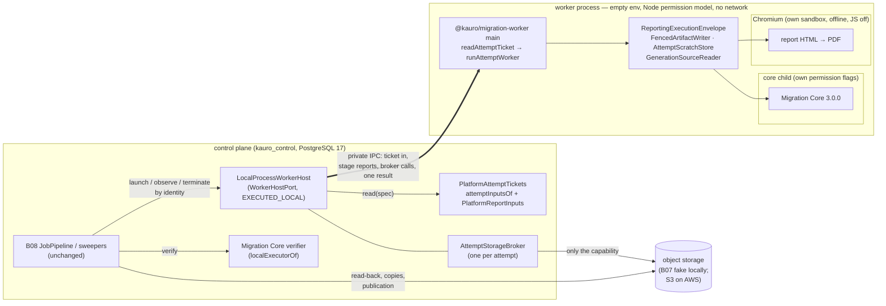

# B14-A — The real worker executor, B13 inside it, and the AWS host's contracts

Order 9, the first part of B14. It is local and synthetic: no AWS account or resource, no customer data, no real secret, no
deployment. It builds a real executor that runs **Migration Core 3.0.0 and the B13 PDF report in an isolated process**, under B08's
unchanged control plane. It also selects the AWS host from the official documentation, without qualifying it ([B14-A-aws-host-qualification.md](B14-A-aws-host-qualification.md))
and writes the deployment contracts ([deploy/aws/worker/](../../deploy/aws/worker/README.md)). It does not complete B14, and nothing
here is production-ready.

## 1. What existed, what was simulated, what was not connected (preflight, `main` 9dd3a3b3)

| Piece | State before order 9 |
|---|---|
| `WorkerHostPort` (`application/ports/worker-host.ts`) | Port only. The only implementer was `ContractFakeWorkerHost`, an **in-process** executor (SIMULATED) that every B08 and B13 control-plane test bound. |
| `MigrationCoreAdapter` (B05) | Real (EXECUTED_LOCAL), and tested on its own. The B08 pipeline never ran it: every B08 and B13 end-to-end test bound a core that replays an acceptance package. |
| `ReportingExecutionEnvelope`, `PlatformReportInputs`, `FencedArtifactWriter`, `AttemptScratchStore`, `ChromiumPdfEngine` | Real, each tested; never in one process with the real core, and never outside the test process. |
| A composition root for a worker | None (`@kauro/migration-worker` was reserved in `architecture.rules.json`; no package). |
| The core's configuration at execution | **Not connected.** The pipeline's `specOf` passes the platform's plan body and plan hash as `configDocument`/`configHash`. The real adapter needs the core plan binding (`core_plan_bindings`, D5-16). |
| The revision's inputs as the core reads them (`CoreInputResolver`) | **No implementation** outside tests. |
| The real verifier inside the pipeline | **Not connected.** `MigrationCoreAdapter.verify` needs `controls.limits`, which `JobPipeline.verify` does not pass. |
| Execute vs. validate package | **Different bytes** (found here, §9 F1): every real report would have been refused. |
| A worker without database credentials | Asserted in design (D8-ATT-2), never exercised: no worker process existed. |

## 2. Composition and security boundaries

Boundaries, from the outside in:

1. **No credential crosses into the worker.** Its environment is empty; only `SystemRoot` is passed, plus on Windows the variables
   libuv requires for CreateProcess. It never opens a database connection. Every report input arrives inside the ticket, already
   read by the control plane, and the worker verifies each one again (`assembleReportFacts`).
2. **Every object goes through the broker.** The broker admits only the attempt's sealed generations for reading and its own
   staging prefix for writing. It hands out opaque session handles; the provider's bearer reference never reaches the worker. After
   a termination, a deadline or the result, it is revoked.
3. **The process is confined.** The Node permission model lets the worker read only the code, the browser's directory and its own
   attempt directory, and write only that directory. The network entry points are refused (the sandbox preload). **Its process
   allowlist** (`host/worker-preload.ts`) lets it start only two programs. One is the core's Node child, exactly as
   `core-child-runner.ts` starts it: a closed command line (`--permission`, read grants and one write grant within the worker's own,
   `--disallow-code-generation-from-strings`, a heap no larger than the worker's `--core-heap-mb`, the network preload, the fs preload
   and the core child's entry, nothing after it), no environment but `SystemRoot`, not detached. So a negation such as
   `--no-permission`, an `-e` script, another entry or a child without the network preload is refused (review R2-1, R2-2). The
   other is the named browser without any flag that turns a sandbox layer off. Every other program, every `shell` option of the
   synchronous exports, every shell command line and `process.execve` is refused before a process exists (R2-3); on Windows nothing
   is started detached, so every child stays in the worker's kill-on-close job. The permission model already refuses
   `process.binding`, workers, addons and WASI, so `child_process` is the only way to a process. The heap is bounded, and so are the
   scratch quota and the wall clock.
4. **A supervisor beside it** (`host/supervisor.ts`), outside the confinement and holding no customer data, ends the worker's whole
   tree without the worker's cooperation: when the host dies (its pipe closes), at the deadline whether or not the host lives, and
   when the tree's resident memory (Linux) or the attempt directory passes the attempt's hard limits. The worker gets its ticket
   only once its supervisor says it watches; a supervisor that cannot start, does not say so within 15 s, or ends while the worker
   runs without having ended it ends the attempt (`FAILED WORKER_CRASHED`, `SUPERVISOR_LOST`; review R4-1). The supervisor knows the
   worker by its pid and (Linux) the start the host recorded at the spawn, and never signals the pid, or discovers a tree under it,
   once that no longer matches (review R4-2).
5. **Inside the worker,** the core runs in its own child with narrower flags (B05). Chromium runs with its own sandbox, offline, with
   JavaScript off and every request aborted (B13).
6. **On AWS** (qualification §4), the task, its container and its per-attempt IAM role are the operating-system boundary. The
   worker's code is the same.

## 3. The attempt ticket (KAURO_ATTEMPT_TICKET_V1)

The ticket is the worker's one closed input, built by the host at launch (`packages/data-plane/src/host/ticket.ts`). It contains:
the B08 launch spec (identity, capability, subject, limits, fence); the **core plan binding** of the job's plan; the revision's
INCLUDED files as the core reads them (`source_files.format`); the report's inputs (`PlatformReportInputs.read(scope)`); the render
configuration; the expected core package hash; and the instant of issue. Bytes inside it are encoded as `{"$bytes": base64}`.

- The worker checks the ticket's raw SHA-256 against the digest on its command line. The bytes must be exactly the canonical
  encoding: one spelling only.
- `attemptTicketProblems` refuses: another attempt's identity, capability or subject; no fence; limits past their hard bounds; no
  binding; inputs that are not exactly the capability's sealed generations; a read configuration the core cannot use; no render; no
  core hash; no deadline; any member that does not belong.
- The host checks the same before it creates anything (`REFUSED`, nothing created). The worker checks again before it touches
  storage (`FAILED REFUSED`).
- The plan binding is applied by the worker (`planBound` in `worker-runtime.ts`): the core runs on the binding's document and its
  core-native hash, which is what D5-16 requires ("execute translates a plan only through this row"). The B08 pipeline and its
  `ExecutionSubject` are unchanged.

The report's inputs are read **at launch**, not at print time, so the worker needs no channel to the database. Those records are
immutable (quote preimage, legal identity, the branding bound once per job, the audit's findings, the approval's disclosures). The
authority facts that can change (authorization, approval, source, target, capability) are read again by B08's publication guard,
which refuses a stale package as before.

## 4. The local worker protocol and the broker

The worker and its host talk over a private IPC channel with Node's advanced serialization (`host/protocol.ts`, `client.ts`,
`broker.ts`):

- host → worker: `ticket`, `reply`, `signal` (the host's mirror of the lease's cancellation, D8-CANCEL-1);
- worker → host: `call` (a stage report, or a storage call to the broker), `beat` (a heartbeat at each cancellation check),
  `result` (sent once).

Stage reports (`STARTED`, `CORE_STARTED`, `CORE_FINISHED`, `PDF_STARTED`, `PDF_FINISHED`, `MANIFEST`, `FINISHED`) are calls the host
answers. A deployment answers them at once; a test can hold one. That is how the tests below terminate, cancel or time out at an
exact point without sleeping.

The broker refuses with a token and keeps each refusal (operation and token) as evidence. Reads are pulled one chunk at a time, at
most 1 MiB, so memory stays bounded.

## 5. The local process host and its limits

`LocalProcessWorkerHost` (`host/local-process-host.ts`):

- **Creation by identity.** The job's directory is prepared aside with its ticket and its first record, then renamed to
  `jobs/<identity>`. A rename refuses a non-empty target, so the identity never exists without its record, and a second launch, a
  concurrent one, a redelivery or another host instance over the same root answers `ALREADY_EXISTS`.
- **No late create.** The control plane's records are read before the create, under a bound of half the creation horizon. A launch
  whose read outlasts that bound, or whose identity is terminated meanwhile, creates nothing when the read lands (review R3). A
  termination of an absent identity takes its name for good, by the same rename a create uses (a tombstone that observe still answers
  `NOT_FOUND`): every pending launch, of any instance over the root, then finds the name taken and answers `REFUSED`
  (`IDENTITY_TERMINATED`), so the `NOT_FOUND` it answered stays true (review R2-4).
- **One end, for good.** The durable record (`record.json`, written atomically) holds state, pid, instants, cause, manifest
  reference, refusal, peaks and the exact command line, never a customer value. A job's end is `end.json`, created exclusively (a
  hard link that fails if the end exists): of a result, a termination, a deadline and another instance's verdict, the first end
  stands and every later one adopts it.
- **Configuration refused before it exists.** Relative paths, a missing entry or browser, no code roots, a host or scratch root
  that overlaps a code root the worker can read, overlapping host and scratch roots, a non-https session origin, or a malformed core
  hash. At launch, the two heaps plus the browser's reserve must fit in the attempt's hard memory.
- **Limits.**
  - Memory: `--max-old-space-size` on the worker and `heapMegabytes` on the core child, with the browser's reserve, must fit inside
    the attempt's `hardMemoryBytes` (checked at launch). The supervisor reads the whole tree's resident memory, native allocations
    and the browser included, and ends the tree past `hardMemoryBytes` (`MEMORY_EXHAUSTED`). It does this on Linux, from /proc. On
    Windows only the heaps are bounded locally; the cloud task's memory limit is the container's.
  - Disk: the attempt's scratch budget is enforced inside (AttemptScratchStore, the core's byte ledger). The supervisor measures the
    whole attempt directory, so it also counts writes outside those quotas and the browser's profile, and ends the tree past
    `hardScratchBytes` (`SCRATCH_EXHAUSTED`). It also counts the browser's own temporary directory (below).
  - The browser's temporary directory: `<scratchRoot>/kb-<12 hex of the attempt id's SHA-256>`, made by the host (mode 0700), named
    to the browser alone as `TMPDIR`/`TMP`/`TEMP`, never granted to the worker, and removed by the host when the worker's tree ends
    (or by a later instance once it has declared the job ended). The browser binds its singleton socket there, and a socket's path is
    at most 107 bytes on POSIX: the attempt's own directory is too deep for it (finding F6). So on POSIX the host refuses a scratch
    root longer than 45 bytes.
  - Time: the worker's own deadline (the adapter's `Operation`); the host's timer at the earlier of the execution deadline and the
    wall clock; and the supervisor's own timer, which still fires if the host has died.
- **Termination** closes the broker at once, kills the worker's whole tree at once and records the end. Only then are the provider's
  sessions cancelled and reads released, each bounded, in the background, so no provider call can hold a termination or a deadline
  back (review R6). A session or a read that lands after the closing is cancelled and never handed over (review R5). On Linux the kill
  walks `/proc` and then kills the worker's process group; on Windows it uses `taskkill /T /F`.
- **The worker's end is not the attempt's** (review R2-6). Before the host records a worker's end or removes the browser's directory,
  it sweeps what the worker may have left (`sweepAttemptProcesses`, Linux): the worker's process group, and every process of the user
  that the attempt's directories mark — a working directory inside the attempt's, or an environment value naming it or the browser's
  directory (the browser runs in a session of its own) — and records the end only once none is left, or after a bounded wait, when
  the supervisor sweeps on. The supervisor also keeps every process it has seen in the worker's tree, by pid and start, and sweeps
  them with the marked ones whenever the worker is gone. On Windows every child is in the worker's kill-on-close job, which ends with
  the worker; the browser's own children end with the browser.
- **Restart and other instances.** Each host instance renews an `instances/<id>` file every 5 s. Another instance answers a job by
  its record as it stands (`RUNNING`) while the owning instance is alive. It declares the job `FAILED WORKER_CRASHED`
  (`HOST_RESTARTED`) only once the owner has been silent for 30 s **and** the tree is known to have ended: the supervisor's verdict
  (`HOST_LOST`), or a pid that no longer exists or now names another process, and (Linux) no process the attempt marks (review R4,
  R7). A silent owner is never proof that its worker is dead (review R2-5): another instance terminates a job, live or lost owner
  alike, by the worker's pid once the pid is proved the job's (its command line, from /proc or CIM, names the job's ticket digest),
  sweeps the attempt's marked processes and records `TERMINATED` only once the tree is gone. If it cannot tell (the command line
  cannot be read, or the tree outlives the bound) it answers `UNCERTAIN` and changes nothing. It leaves a `terminate.request` in the
  job's directory first, so the owner, reading the worker's exit without a result, records the same termination. A
  worker whose host's channel closes also ends itself (`killOwnTree`), and a worker stuck in synchronous work is ended by its
  supervisor. On Windows the operating system does it first: libuv puts a process's children in a kill-on-close job object, so the
  worker's whole tree ends with the host; the supervisor is started detached, outside that job, and records `HOST_LOST`. B08 then abandons the attempt and takes it over at fence + 1.

**Residual (local only) — not a boundary against a compromised worker.** Locally, all of the above runs as one operating-system
user with no OS sandbox. What the operating system or Node's C++ permission model enforces holds against any code in the worker:
the files it may read and write, no credential in its environment (boundary 1), no storage except through the broker (boundary 2),
no worker threads, addons or WASI. What is enforced in the worker's own JavaScript realm does **not** hold against code that already
runs there (a compromised worker):

- the process allowlist (§2 item 3). Its rules, the functions it calls and the permission check are private and captured at load
  (review R3-1), but such code can still tamper with the JavaScript intrinsics the guard relies on. Node's `--frozen-intrinsics`
  would stop that, and the browser driver fails under it (it assigns `Error.stackTraceLimit`). Since the worker needs
  `--allow-child-process`, such code can then start a program outside Node's permission model;
- the network preload, likewise;
- the named browser, which the allowlist admits and which Node's permission model does not confine: such code could drive it over
  its pipe to a `file:` URL.

The hostile-worker test proves that every direct way out a worker's code could take is refused (it does not prove the realm itself
tamper-proof). A program so started would run as the same user, so it could read another attempt's leftover scratch before the
janitor removes it, or the host's files. The local host is therefore qualification and single-tenant development infrastructure,
for the platform's own code, never for another tenant's. Multi-tenant isolation belongs to the cloud task: one attempt per
container, with its own filesystem, its own role and its own process namespace. An OS sandbox for the local host (a container,
bubblewrap, or a Windows job object with an AppContainer) would close this residual and is not built: it is a blocker (§11).

**Local limits that are not enforced** (beyond the residual above): on Windows, the tree's memory beyond the two heaps, and disk
written outside the attempt's directories or held in files whose names were removed. On Linux the supervisor counts those files
through `/proc/<pid>/fd` (review R3-3), but not disk the unconfined browser writes elsewhere. The cloud task's own memory and
ephemeral-storage limits are the hard bound there.

## 6. B13 inside the worker

The report is made exactly as B13 designed it (`ReportingExecutionEnvelope`), now inside the worker process and over the real
core's package:

- The facts come from `PlatformReportInputs`, through the ticket. The renderer never reads a table, and the worker cannot.
- The branding version is the one bound to the job (bound once, at first read). The issuer is the legal identity document whose hash
  the quote's terms name. The commercial display name and the fiscal identity stay separate bindings, as before.
- **The missing legal identity still blocks every real report:** `REPORT_ISSUER_UNAVAILABLE`, job `FAILED REFUSED`, nothing
  published. Tests use only the labelled synthetic TEST identity of `@kauro/persistence/testing`.
- Publication is B08's own: the PDF and its record are artifacts of the staged manifest. A worker killed before its manifest leaves
  nothing that can be submitted, so a package is never published without its report, and never partially.
- Hashes are unchanged: the record names the core's manifest hash, which now equals the receipt's `artifactEvidenceHash` (§9 F1).

## 7. The control plane's side

- `attemptInputsOf(uow)` (`packages/persistence/src/execution/attempt-inputs.ts`) reads the binding and the sealed files. It runs as
  `kauro_control` bound to the job's agency and needs no new grant (0058 and 0021 already give them); there is no migration.
- `PlatformAttemptTickets` (`apps/control/src/execution/attempt-tickets.ts`) is that read plus `PlatformReportInputs`.
- `localExecutorOf` (`apps/control/src/execution/local-executor.ts`) builds the host, plus a `PackageVerifierPort` over Migration
  Core's own `verify` with the envelope's limits. The deployed control plane still binds no executor (D8-PORT-1).

## 8. Evidence

Windows 11, Node 24.20.0, PostgreSQL 17 (`pg17dl`), Microsoft Edge (Chromium) sandboxed. CI runs the same suites on Ubuntu 24.04 and
Windows with Google Chrome required (`KAURO_REQUIRE_PDF_ENGINE=1`).

| Suite | File | Cases |
|---|---|---|
| Ticket and broker, pure | `packages/data-plane/test/worker-ticket-broker.test.ts` | 6: the session cap under concurrent requests; a session landing after revocation is cancelled; digest, canonical bytes, closed shape (18 refusals), broker OK, broker DENY (14 refusals and revocation) |
| Local executor, happy path | `packages/data-plane/test/local-process-host.test.ts` | 1: real Migration Core and Chromium in a confined process; the manifest names the package, the PDF and its record; scratch removed |
| Local executor, adversarial | `packages/data-plane/test/local-process-host-adversarial.test.ts` | 26: a supervisor killed mid-attempt (SUPERVISOR_LOST); a worker that rewrites its command line, terminated by its recorded identity; a removed-but-open file past the hard scratch (Linux); a launch pending on one instance cancelled through another; a stale owner whose worker lives (killed by a pid proved the job's); the sweep of an attempt's orphans (Linux); two live instances over one root; scratch written outside the quotas (supervisor, SCRATCH_EXHAUSTED); native memory past the hard limit (supervisor, Linux); a launch abandoned while its read is pending and a read past its bound; termination while a storage call never answers; a dead host with a worker stuck in synchronous work (supervisor, HOST_LOST); and the earlier 14: concurrent and duplicate launches and a second host; lost answer and failed read; configuration refused; hostile worker (environment, files, writes, socket, fetch, DNS, broker, residual); memory (heap death recorded MEMORY_EXHAUSTED); disk (SCRATCH_EXHAUSTED); time (DEADLINE_EXCEEDED, and a deadline already past); termination during processing, during the PDF and before publication (no process survives, OS-checked); cancellation and fence; control-plane death (an orphan ends itself, recovery from the record); missing legal identity; altered and forged sealed generations |
| End to end, PostgreSQL 17 | `apps/control/test/b14a-local-executor.test.ts` | 5: OK (package AVAILABLE, job READY, entitlement DELIVERED, verification VALID EXECUTED_LOCAL 3.0.0, delivered manifest = the receipt's, janitor CLEANED with REPORTED resources); S056 lost answer adopted through B08; CMD037 during the run; worker killed, then takeover at fence 2 delivers; no legal identity → FAILED REFUSED |
| Regressions | data-plane, control, persistence, application suites; `pnpm run verify` | B05 adapter (with F1), B08 control plane, B13 report suites unchanged and green |

Set `KAURO_B14A_EVIDENCE_DIR` to make the end-to-end OK case write the delivered PDF, its record, the host's record and the delivery
summary.

Evidence classes: EXECUTED_LOCAL for the host, the worker processes, Migration Core, the browser, the control plane and PostgreSQL.
SIMULATED for B07's object storage (no cloud storage exists locally) and the payment capture (B09's fixtures). **Nothing here is
EXECUTED_PROVIDER.**

## 9. Findings fixed (each with the test that shows it)

| # | Finding | Fix |
|---|---|---|
| F1 | `execute` ran without the source profile that `validate` builds. The staged package therefore never had the receipt's `artifactEvidenceHash`, and every real report was refused `PACKAGE_BINDING_MISMATCH`. | `child-task.ts`: execute builds the profile exactly as validate does. The package is now byte for byte the validated one (asserted end to end). |
| F2 | The B08 subject carries the plan body and plan hash, not the core's configuration. | The worker applies the plan binding from the ticket (§3). B08 is unchanged. |
| F3 | The real verifier needs `controls.limits`; the pipeline passes none. | `localExecutorOf` binds the verifier with the plane's limits. |
| F4 | Under Node 24's permission model `fsync` is disabled, and a directory's contents are granted only if the directory exists when the process starts. | The host creates the attempt directory before spawning. `AttemptScratchStore` gains `confined` (no root `mkdir`, no `fsync`; the length on the device is still checked). |
| F5 | On Windows a process's working directory cannot be removed. | The worker's working directory is the scratch root, which it cannot read. |
| F6 | On Linux the browser aborted at launch inside the worker (`process_singleton_posix.cc: Socket path too long`): its singleton socket went under the attempt's directory, past the 107-byte limit of a socket path. Windows has no such socket, so only the Ubuntu CI leg showed it. | The browser's own short temporary directory beside the scratch (§5); a scratch root too long for it is refused at configuration. |
| R1 | (independent review, round 1) A native child of the worker escaped the permission model. | The process allowlist (§2 item 3); the hostile worker's native, shell, wider-permission and `NODE_OPTIONS` children are refused. The narrowed residual is stated in §5. |
| R2 | Heap caps are not the attempt's hard memory or scratch. | The supervisor measures the tree's resident memory (Linux) and the attempt directory (all platforms). |
| R3 | A slow record read could create a job after the horizon. | A bounded read; a launch abandoned meanwhile creates nothing. |
| R4 | Another live instance declared a running job dead. | Instance liveness; an end only once the tree is known to have ended; `end.json`, where the first end stands. |
| R5 | A session created after revocation survived it. | The broker checks again after each provider answer and cancels a late session. |
| R6 | Termination waited on provider cleanup; an exit could overwrite a termination. | Synchronous close, kill and record, with cleanup afterwards; the first end stands. |
| R7 | A worker stuck in synchronous work outlived its dead host. | The supervisor ends the tree when the host's pipe closes. |
| R8–R10 | The AWS document claimed a guaranteed 900 s horizon and permanent single creation, inferred an end from absence, and blocked multipart uploads. | The verdict became `SELECTED_NOT_QUALIFIED`; the token's guaranteed hour, a recorded ARN, no end from absence; the multipart steps are allowed by `s3:ObjectCreationOperation`. |
| R2-1, R2-2 | (round 2) A Node child could follow `--permission` with `--no-permission`, or run an `-e` script without the network preload. | The core child's closed command line is the only Node child (§2 item 3); the hostile worker's negation and network children are refused. |
| R2-3 | The synchronous exports' `shell` option became a shell behind an allowed program. | The option is refused in both wrappers; asynchronous shells already reach the guard as the shell's own command line; `process.execve` is removed. |
| R2-4 | A termination abandoned only the last pending launch of one instance. | Every pending launch is abandoned, and the identity's name is taken for good by the same rename a create uses, across instances. |
| R2-5 | A stale owner made another instance record a termination without killing. | The pid is proved the job's and killed; the end is recorded only once the tree is gone, else `UNCERTAIN`. |
| R2-6 | A child surviving the worker escaped supervision. | The host and the supervisor sweep the attempt's processes (group, seen, marked) before the end is recorded. |
| R3-1 | (round 3) The allowed child's specification was exported and mutable. | Private and frozen; the guard's functions and the permission check are captured at load; probes show neither reachable. The realm-level residual is stated, and listed as a blocker (§5, §11). |
| R3-2 | A worker could rewrite its own command line and pass for a reused pid. | The worker's Linux start is recorded at spawn and compared; an unreadable identity is `UNKNOWN`, never an end; a cell with a worker that rewrites its title. |
| R3-3 | A file whose name was removed escaped the scratch measure. | The supervisor counts files the tree holds open after their names were removed (Linux, /proc); Windows stated as unenforced. |
| R4-1 | (round 4) A worker ran on when its supervisor failed to start or ended. | The ticket waits for the supervisor's word; its loss ends the attempt (`SUPERVISOR_LOST`); a cell kills a supervisor mid-attempt. |
| R4-2 | The supervisor could signal a reused worker pid. | It receives the worker's recorded start and checks it before every signal and discovery; the group only while the pid is the worker's or names no process. |
| R4-3 | The api loader census pinned the preload's `node:module` import at a stale line. | The exact line is updated; the census stays strict. |
| R4-4 | Concurrent session requests passed the broker's cap together. | A session's number is taken before the provider is asked; a cell with two concurrent requests and a cap of one. |

## 10. Decisions

| Id | Decision |
|---|---|
| D14A-1 | The local executor is a `WorkerHostPort` of its own (EXECUTED_LOCAL). The port's evidence class widens to `WorkerHostEvidenceClass` = provider classes + EXECUTED_LOCAL; the janitor's rule (EXECUTED_PROVIDER only from a provider host and provider storage) is unchanged. |
| D14A-2 | The worker reads nothing of the platform but its ticket. The report's inputs are read at launch by the control plane (§3). |
| D14A-3 | Storage is brokered locally; on AWS it is per-attempt IAM (qualification §4). The same object names and preconditions apply in both. |
| D14A-4 | The host creates by an exclusive directory per identity (locally) or by `clientToken` plus a conditional claim object (AWS). Neither relies on a provider's search by name. |
| D14A-5 | The worker's clock is the product's fifth process-clock injection point (CK3, `apps/migration-worker/src/main.ts` `workerClock`). |
| D14A-6 | `BrokeredObjectStorage` is a real implementer of `ObjectStoragePort` (a client of the broker, not a fake). The B07 single-fake check lists it explicitly. |
| D14A-7 | The new areas (`apps/migration-worker/**`, `deploy/**`) are attributed to B08 and B13 in the acceptance ledger: a change to them re-touches both. |

## 11. Still blocked (needs AWS, the legal identity, or another service)

- **AWS:** account, provisioning authorization, Terraform, the image's first build, `EcsFargateWorkerHost`, B15's S3 adapter and its
  generation mapping, and the live probes of the qualification's §6 (token, Chromium sandbox on Fargate, IAM life cycle, bucket
  policy, pull time, task retirement). Until then: no EXECUTED_PROVIDER, no G-CLOUD, no `B14_COMPLETO`.
- **Legal identity:** every real report is refused until the owner records it (`docs/owner/LEGAL_IDENTITY_SNAPSHOT.md`).
- **Local OS sandbox (blocker for any use of the local host beyond single-tenant qualification):** the process allowlist and the
  network preload are not a boundary against code already running in a worker (§5, residual). An OS sandbox (container, bubblewrap,
  AppContainer), or the cloud task, is that boundary. Not built in B14-A.
- **Not in B14-A:** B14's database, API, queues and network beyond the worker; B04 and Bedrock.
